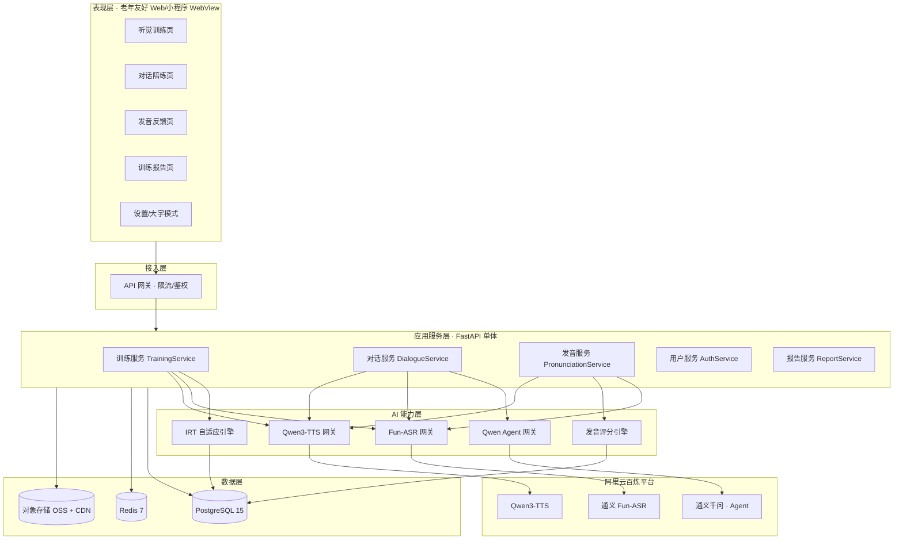
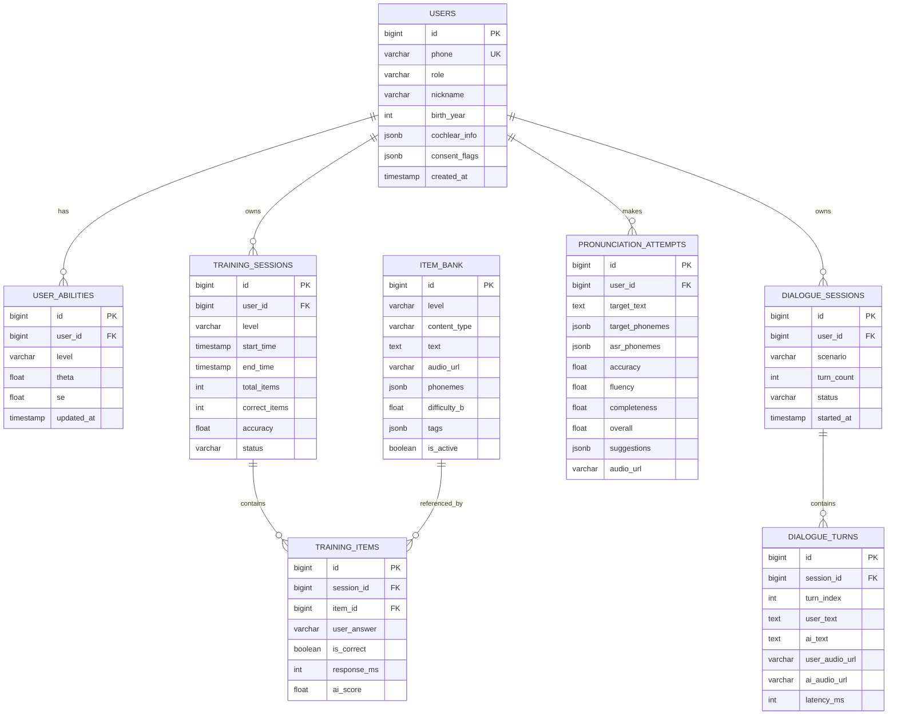
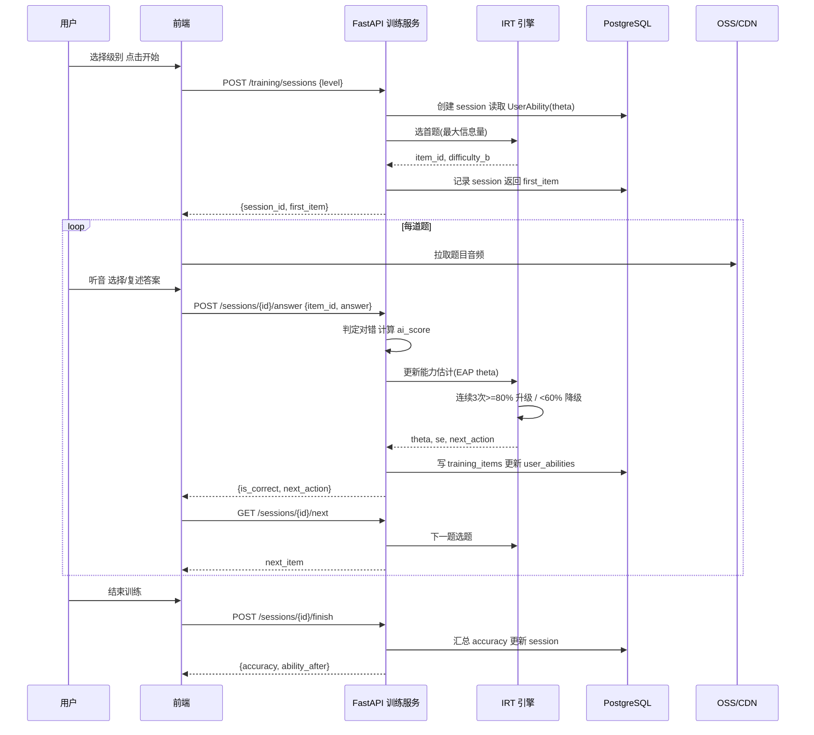
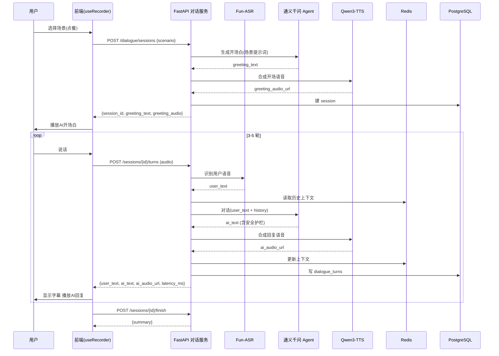
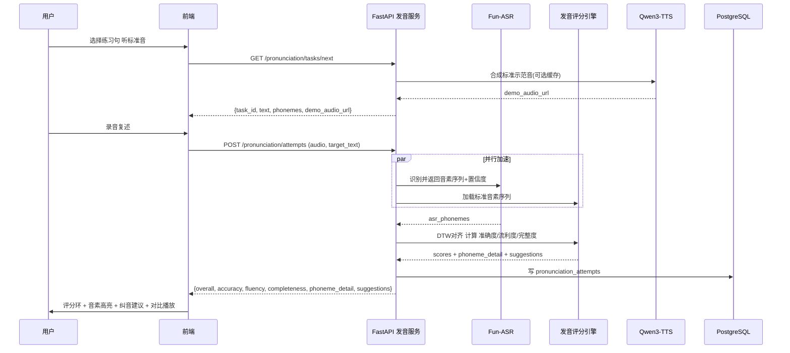

# AI 辅助人工耳蜗术后听觉康复助手 — 技术栈选型 + 开发计划

> 文档版本：v1.0　|　阶段：MVP（0-3 个月 / 天猫 AI 黑客松）　|　作者：Bob（架构师）
> 上游输入：`prd_cochlear_rehab_assistant.md` v1.0
> 定位：听觉训练与健康教育工具（**非医疗器械**）

---

## 0. 一句话架构结论

> **Vite + React 18 + TS + MUI + Tailwind** 前端（移动端优先、老年友好），**Python FastAPI** 单体后端（AI 生态友好、异步高并发），**阿里云百炼**串联 Fun-ASR / Qwen3-TTS / 通义千问，**PostgreSQL** 存业务数据、**Redis** 做会话与缓存，**阿里云函数计算 FC + RDS + OSS** 部署（Serverless，降运维）。核心差异化在 **IRT 自适应难度引擎** 与 **音素级发音评分**。

---

## 1. 技术栈总览表（重点）

### 1.1 前端层

| 层级 | 技术选型 | 版本 | 选型理由 |
|------|---------|------|---------|
| 构建工具 | **Vite** | ^5.2 | 冷启动秒级、HMR 极快，黑客松迭代效率优先；相比 CRA 更轻、相比 Next.js 无需 SSR（本项目为登录后工具型应用，SSR 收益低） |
| 框架 | **React** | ^18.2 | 生态最丰富（音频/录音/Accessibility 组件全），团队熟悉度高；Concurrent 特性利于语音流式渲染 |
| 语言 | **TypeScript** | ^5.3 | 强类型保障 AI 接口出入参与训练数据结构一致性，降低联调成本 |
| UI 组件库 | **MUI (Material UI)** | ^5.14 | 开箱即用的无障碍支持（ARIA/键盘导航）+ Slider/Button 尺寸可控，便于老年适配；与 Tailwind 互补 |
| 样式方案 | **Tailwind CSS** | ^3.4 | 原子类快速堆砌布局；通过 `tailwind.config` 集中定义字号（≥18px）/触控尺寸（≥48px）token，老年适配一处生效 |
| 路由 | **React Router** | ^6.22 | 社区标准，支持嵌套路由与懒加载 |
| 服务端状态 | **TanStack Query** | ^5.28 | 缓存/重试/竞态处理开箱即用，配合 AI 接口的 loading/错误态 |
| 客户端状态 | **Zustand** | ^4.5 | 轻量全局状态（当前训练会话、音量大字体设置），避免 Redux 样板 |
| HTTP 客户端 | **axios** | ^1.6 | 拦截器统一处理鉴权 token 与错误码 |
| 音频采集 | **MediaRecorder API** + **recorder-core** | 浏览器原生 / ^1.3 | 免依赖获取 PCM/WAV，兼容微信内置浏览器；recorder-core 提供格式兜底 |
| 波形可视化 | **wavesurfer.js** | ^7.7 | 发音反馈页展示用户与标准音对比波形 |
| 图表 | **ECharts (echarts-for-react)** | ^5.5 | 训练报告趋势图（正确率曲线、依从率），中文文档完善 |
| 语音播报 | **Web Speech API**（兜底）+ Qwen3-TTS | 原生 | 页面语音引导（老年适配）；TTS 服务不可用时本地兜底 |

### 1.2 后端层

| 层级 | 技术选型 | 版本 | 选型理由 |
|------|---------|------|---------|
| 语言 | **Python** | 3.11 | **首选**：AI 生态最强（numpy/scipy 做 IRT、音频处理库丰富）、百炼 SDK `dashscope` 官方首选 Python；Node.js 取舍见下 |
| Web 框架 | **FastAPI** | ^0.110 | 原生异步（ASR/TTS/LLM 均为 IO 密集，异步可撑 100+ 并发）；Pydantic 自动校验 + 自动生成 OpenAPI 文档，前后端联调快 |
| ASGI 服务器 | **Uvicorn** | ^0.29 | 轻量高性能，配合 gunicorn 多 worker |
| ORM | **SQLAlchemy** | ^2.0 | 成熟 ORM，异步 session 支持；JSONB 类型直接映射 PostgreSQL |
| 迁移 | **Alembic** | ^1.13 | 数据库版本化迁移，团队协作必备 |
| 校验/序列化 | **Pydantic** | ^2.6 | 请求/响应 DTO，与 FastAPI 一体 |
| 数据库驱动 | **asyncpg** | ^0.29 | 异步 PostgreSQL 驱动，性能最优 |
| 缓存/会话 | **Redis** | 7.x (redis-py ^5.0) | 对话上下文、限流、一次性验证码、训练会话状态 |
| 任务队列 | **ARQ**（轻量） | ^0.26 | 异步任务（周报生成、数据脱敏）；基于 Redis，比 Celery 轻，Serverless 友好 |
| 鉴权 | **python-jose**[cryptography] + **passlib**[bcrypt] | ^3.3 / ^1.7 | JWT 签发校验 + 密码哈希 |
| HTTP 客户端 | **httpx** | ^0.27 | 异步调用百炼/第三方登录 |
| 日志/监控 | **loguru** + **OpenTelemetry** | ^0.7 / ^1.x | 结构化日志 + 链路追踪 |

**后端语言取舍（Python 优先，明确理由）：**

| 维度 | Python (FastAPI) ✅ 推荐 | Node.js (NestJS) |
|------|--------------------------|------------------|
| AI/算法生态 | ✅ scipy/numpy 直接实现 IRT 的 MLE/EAP 估计、音频信号处理库齐全 | ⚠️ IRT 需手写数值算法或调 HTTP 服务，信号处理库弱 |
| 百炼 SDK | ✅ `dashscope` Python SDK 功能最全、示例最多 | ⚠️ dashscope 亦有 JS SDK，但异步流式与高级参数覆盖略少 |
| 异步并发 | ✅ asyncio + asyncpg 胜任 IO 密集 | ✅ 原生异步同样优秀 |
| 团队/交付 | ✅ 算法与后端同语言，减少边界 | ⚠️ 与前端同语言，但对算法侧不友好 |

> 结论：**选 Python**。核心原因 = IRT 自适应算法需要 Python 科学计算栈，与百炼 SDK 同栈，避免跨语言算法服务。

### 1.3 AI 能力层（阿里云百炼）

| 能力 | 模型/服务 | 调用方式 | 选型理由 |
|------|----------|---------|---------|
| 语音识别 ASR | **通义 Fun-ASR** | `dashscope` 录音文件识别 / 流式识别 | 中文识别强、支持热词与行业词表（可注入康复词表）；流式首包 <500ms |
| 语音合成 TTS | **Qwen3-TTS** | `dashscope` SpeechSynthesizer | 17 种拟人音色，可选男/女清晰音色用于老年用户 |
| 对话大模型 | **通义千问 (Qwen-Max/Turbo)** | 百炼 Agent 应用 / `dashscope` | Agent 框架内置上下文管理、场景提示词、安全护栏；对话场景 3-5 轮低成本用 Turbo |
| 发音评分 | **Fun-ASR 音素时间戳 + 自研评分** | 后端 Python 服务 | ASR 返回音素级结果，与标准音素序列做 **DTW 对齐 + 音素准确度/流利度/完整度** 打分（<2s 可通过并行 + 缓存达成） |
| 语音克隆（P1） | **Fun-CosyVoice3** | `dashscope` | 3 秒克隆，需用户显式授权，MVP 不启用 |

### 1.4 数据与基础设施层

| 层级 | 技术选型 | 版本 | 选型理由 |
|------|---------|------|---------|
| 主数据库 | **PostgreSQL** | 15 | JSONB 存灵活的训练题库/评分明细，事务可靠、支持窗口函数做趋势分析；优于 MySQL（JSON/CTE 更强）、MongoDB（需强一致事务） |
| 对象存储 | **阿里云 OSS** | — | 音频素材、用户录音、TTS 缓存；配 CDN 加速 |
| 缓存 | **Redis** | 7.x | 见 1.2 |
| 部署 | **阿里云函数计算 FC（Serverless）** | — | 见下方取舍；自动伸缩、按量付费，黑客松阶段成本最低 |
| API 网关 | **阿里云 API 网关** | — | 统一入口、限流、鉴权前置 |
| CI/CD | **GitHub Actions / 云效 Flow** | — | 自动构建、测试、部署 |
| 容器（备选） | Docker + ECS | — | Serverless 冷启动不满足时的降级方案 |

**部署方案取舍（Serverless 优先）：**

| 维度 | Serverless (函数计算 FC) ✅ MVP 推荐 | 云服务器 (ECS + Docker) |
|------|--------------------------------------|--------------------------|
| 运维成本 | ✅ 免运维，黑客松无运维人力 | ❌ 需自行维护安全组、监控、升级 |
| 成本 | ✅ 按调用付费，低流量近乎零成本 | ❌ 按月包年，低峰浪费 |
| 冷启动 | ⚠️ 首次调用有冷启动（可预留实例缓解） | ✅ 常驻无冷启动 |
| 长连接/流式 | ⚠️ 流式语音需注意超时（用预留实例 + 响应流） | ✅ 更易支持长连接 |
| 伸缩 | ✅ 自动弹性到 100+ 并发 | ⚠️ 需手动配置 ASG |

> 结论：**MVP 用 Serverless**（FC + RDS + Redis + OSS），对**流式语音接口预留实例**规避冷启动；P1 流量稳定后可平滑迁 ECS。

### 1.5 自适应算法选型

| 方案 | 说明 | 结论 |
|------|------|------|
| **IRT（项目反应理论）** ✅ | 用能力参数 θ 与题目难度 b 建模，动态选最匹配当前能力的题目 | **MVP 采用**（2PL 简化 + EAP 能力估计） |
| 简化规则引擎 | 普鲁PRD 要求「连续 3 次≥80% 升级 / <60% 降级」 | 作为 **IRT 之上的兜底规则**，保证可解释性与产品需求对齐 |
| 贝叶斯知识追踪 BKT | 更适合知识点掌握追踪 | P1 扩展 |

> MVP 采用 **IRT 能力估计 + 规则阈值双控**：IRT 负责"选什么难度的题"，规则负责"显式升降级"，兼顾效果与 PRD 验收标准。

---

## 2. 系统架构

### 2.1 分层说明

| 层 | 职责 | 关键模块 |
|----|------|---------|
| **表现层（前端 SPA）** | 交互、录音、播放、老年适配渲染 | 训练页 / 对话页 / 发音页 / 报告页 / 设置页 |
| **接入层** | 统一入口、限流、鉴权 | API 网关 + JWT 中间件 |
| **应用服务层** | 业务编排 | 训练服务、对话服务、发音服务、用户服务、报告服务 |
| **AI 能力层** | 模型调用与算法 | Fun-ASR 网关、Qwen3-TTS 网关、Qwen Agent 网关、IRT 引擎、发音评分引擎 |
| **数据层** | 持久化与缓存 | PostgreSQL、Redis、OSS |

### 2.2 架构图



---

## 3. 项目目录结构

```
ai_cochlear_rehab_assistant/
├── README.md
├── docker-compose.yml                 # 本地一键起 PG + Redis
├── .github/workflows/ci.yml           # CI：lint + test + build
│
├── frontend/                          # ── 前端（Vite + React + TS）──
│   ├── index.html
│   ├── vite.config.ts
│   ├── tailwind.config.ts             # 老年适配 token（字号/触控）
│   ├── tsconfig.json
│   ├── package.json
│   └── src/
│       ├── main.tsx                   # 入口，挂载 ThemeProvider/QueryClient
│       ├── App.tsx                    # 路由出口 + 全局布局（大字模式 Context）
│       ├── router/index.tsx           # 路由表（懒加载）
│       ├── theme/index.ts             # MUI 主题 + Tailwind 互通（字体≥18px）
│       ├── api/                       # API 封装层
│       │   ├── client.ts              # axios 实例 + 拦截器（token/错误码）
│       │   ├── training.ts            # 训练接口
│       │   ├── dialogue.ts            # 对话接口
│       │   ├── pronunciation.ts       # 发音接口
│       │   └── auth.ts                # 认证接口
│       ├── hooks/
│       │   ├── useRecorder.ts         # MediaRecorder 封装（录音/停止/转码）
│       │   ├── useAudioPlayer.ts      # 音频播放 + 字幕同步
│       │   └── useSpeechGuide.ts      # 语音引导播报
│       ├── store/
│       │   ├── sessionStore.ts        # 当前训练会话（Zustand）
│       │   └── a11yStore.ts           # 大字/音量/对比度偏好
│       ├── components/
│       │   ├── common/                # 通用组件
│       │   │   ├── BigButton.tsx       # ≥48px 大按钮
│       │   │   ├── RecordOrb.tsx       # 录音主按钮（呼吸动效）
│       │   │   ├── LevelBadge.tsx      # 级别徽章
│       │   │   └── ScoreRing.tsx       # 评分环
│       │   └── layout/AppShell.tsx     # 底部大标签导航
│       ├── pages/
│       │   ├── Login/                  # 登录/注册
│       │   ├── Home/                   # 首页（四大入口卡片）
│       │   ├── Training/               # 分级听觉训练
│       │   ├── Dialogue/               # 场景对话陪练
│       │   ├── Pronunciation/          # 发音/构音反馈
│       │   ├── Report/                 # 训练报告
│       │   └── Settings/               # 无障碍设置
│       └── types/index.ts             # 前端共享类型
│
└── backend/                           # ── 后端（FastAPI）──
    ├── pyproject.toml                 # 依赖声明（poetry/uv）
    ├── alembic.ini
    ├── alembic/versions/              # 迁移脚本
    └── app/
        ├── main.py                    # FastAPI 入口，挂载路由/中间件/CORS
        ├── core/
        │   ├── config.py              # Pydantic Settings（读环境变量）
        │   ├── security.py            # JWT 签发/校验、密码哈希
        │   ├── deps.py                # 依赖注入（get_db/get_current_user）
        │   └── errors.py              # 统一错误码与异常处理器
        ├── db/
        │   ├── base.py                # SQLAlchemy Base / 引擎 / Session
        │   └── init_db.py             # 种子数据（题库）
        ├── models/                    # ORM 模型（表）
        │   ├── user.py
        │   ├── training.py            # TrainingSession / TrainingItem / UserResponse
        │   ├── item_bank.py           # ItemBank（音素/词/句/噪声）
        │   ├── dialogue.py            # DialogueSession / DialogueTurn
        │   ├── pronunciation.py       # PronunciationAttempt
        │   └── ability.py             # UserAbility（IRT θ 参数）
        ├── schemas/                   # Pydantic DTO
        │   ├── training.py
        │   ├── dialogue.py
        │   ├── pronunciation.py
        │   ├── auth.py
        │   └── common.py              # ApiResponse[T] 泛型包裹
        ├── services/                  # 业务逻辑
        │   ├── auth_service.py
        │   ├── training_service.py
        │   ├── dialogue_service.py
        │   ├── pronunciation_service.py
        │   └── report_service.py
        ├── ai/                        # AI 能力封装
        │   ├── asr_gateway.py         # Fun-ASR 调用
        │   ├── tts_gateway.py         # Qwen3-TTS 调用 + 缓存
        │   ├── llm_gateway.py         # 通义千问 Agent 调用
        │   ├── irt_engine.py          # IRT 能力估计 + 选题
        │   └── pronunciation_scorer.py# 音素对齐与评分
        ├── api/v1/                    # 路由层
        │   ├── router.py              # 汇总路由
        │   ├── auth.py
        │   ├── training.py
        │   ├── dialogue.py
        │   ├── pronunciation.py
        │   └── report.py
        ├── tasks/                     # ARQ 异步任务
        │   ├── worker.py
        │   └── report_weekly.py
        └── tests/                     # pytest
            ├── test_irt_engine.py
            ├── test_training_api.py
            └── test_pronunciation.py
```

**关键文件职责速览：**

| 文件 | 职责 |
|------|------|
| `frontend/src/api/client.ts` | 统一 axios 实例，注入 JWT、统一解包 `{code,data,message}`、401 自动跳登录 |
| `frontend/src/hooks/useRecorder.ts` | 跨浏览器录音（含微信 WebView 兼容）、静音截止、上传 FormData |
| `frontend/src/theme/index.ts` + `tailwind.config.ts` | 老年适配核心：字号 ≥18px、触控 ≥48px、高对比度 token |
| `backend/app/ai/irt_engine.py` | IRT 2PL 能力估计（EAP）+ 最大信息量选题 + 升降级规则 |
| `backend/app/ai/pronunciation_scorer.py` | ASR 音素序列与标准音素 DTW 对齐，输出准确度/流利度/完整度 |
| `backend/app/services/dialogue_service.py` | 场景提示词、3-5 轮上下文（Redis）、安全护栏、多轮编排 |
| `backend/app/core/errors.py` | 统一错误码与异常→响应映射 |

---

## 4. 核心数据模型（8 张核心表）

> 设计原则：业务表用强类型字段，灵活结构（题库选项、评分明细）用 `JSONB`；所有表含 `created_at/updated_at`。

### 4.1 表清单

| 表名 | 说明 | 关键字段 |
|------|------|---------|
| `users` | 用户（患者/听力师） | id, phone, role, nickname, birth_year, cochlear_info(JSONB), consent_flags(JSONB) |
| `user_abilities` | IRT 能力参数（按训练级别） | id, user_id, level, theta, se, updated_at |
| `item_bank` | 训练题库 | id, level, content_type, audio_url, text, phonemes(JSONB), difficulty_b, tags, is_active |
| `training_sessions` | 一次训练会话 | id, user_id, level, start_time, end_time, total_items, correct_items, accuracy, status |
| `training_items` | 会话内单题记录 | id, session_id, item_id, user_answer, is_correct, response_ms, ai_score |
| `dialogue_sessions` | 对话陪练会话 | id, user_id, scenario, turn_count, status, started_at |
| `dialogue_turns` | 对话轮次 | id, session_id, turn_index, user_text, ai_text, user_audio_url, ai_audio_url, latency_ms |
| `pronunciation_attempts` | 发音评估记录 | id, user_id, target_text, target_phonemes(JSONB), asr_phonemes(JSONB), accuracy, fluency, completeness, overall, suggestions(JSONB), audio_url |

### 4.2 ER 图



---

## 5. API 接口列表（RESTful，前缀 `/api/v1`）

> 统一响应：`{ "code": 0, "data": {...}, "message": "ok" }`（错误时 code≠0，见 §10）。

### 5.1 认证与用户

| 方法 | 路径 | 说明 | 请求/响应概要 |
|------|------|------|--------------|
| POST | `/auth/sms/send` | 发送短信验证码 | req: {phone} → data: {expire_in} |
| POST | `/auth/login` | 手机号+验证码登录（或微信 code 登录） | req: {phone, code} / {wx_code} → data: {token, user} |
| GET | `/users/me` | 获取当前用户信息 | → data: User |
| PUT | `/users/me/preferences` | 更新无障碍偏好（字号/音量） | req: {font_scale, volume} → data: {} |

### 5.2 听觉训练（P0）

| 方法 | 路径 | 说明 | 请求/响应概要 |
|------|------|------|--------------|
| GET | `/training/levels` | 获取四级训练进度概览 | → data: [{level, theta, mastery, item_count}] |
| POST | `/training/sessions` | 开始一次训练会话 | req: {level} → data: {session_id, first_item} |
| GET | `/training/sessions/{id}/next` | 获取下一题（IRT 选题） | → data: {item_id, text, audio_url, options} |
| POST | `/training/sessions/{id}/answer` | 提交答案并返回自适应决策 | req: {item_id, answer, response_ms} → data: {is_correct, ai_score, next_action(up/keep/down)} |
| POST | `/training/sessions/{id}/finish` | 结束会话 | → data: {accuracy, total_duration, ability_after} |
| GET | `/training/items/{id}/audio` | 获取题目音频（签名 URL） | → 302/OSS 签名 URL |

### 5.3 对话陪练（P0）

| 方法 | 路径 | 说明 | 请求/响应概要 |
|------|------|------|--------------|
| GET | `/dialogue/scenarios` | 场景列表（点餐/问路/电话） | → data: [{code, name, desc, rounds}] |
| POST | `/dialogue/sessions` | 开始对话会话 | req: {scenario} → data: {session_id, ai_greeting_text, ai_greeting_audio} |
| POST | `/dialogue/sessions/{id}/turns` | 提交一轮语音（返回 ASR+AI 回复+TTS） | req: FormData(audio) → data: {user_text, ai_text, ai_audio_url, turn_index, latency_ms} |
| POST | `/dialogue/sessions/{id}/finish` | 结束并生成小结 | → data: {summary, turn_count} |

### 5.4 发音反馈（P0）

| 方法 | 路径 | 说明 | 请求/响应概要 |
|------|------|------|--------------|
| GET | `/pronunciation/tasks/next` | 抽取发音练习任务 | → data: {task_id, text, phonemes, demo_audio_url} |
| POST | `/pronunciation/attempts` | 提交录音，返回音素级评分 | req: FormData(audio, target_text) → data: {overall, accuracy, fluency, completeness, phoneme_detail[], suggestions[], tts_demo_url} |
| GET | `/pronunciation/attempts` | 历史发音记录 | → data: [Attempt...] |

### 5.5 报告（P1）

| 方法 | 路径 | 说明 | 请求/响应概要 |
|------|------|------|--------------|
| GET | `/report/summary` | 用户训练概览（周时长/正确率趋势/依从率） | query: ?range=7d → data: {duration, accuracy_curve[], adherence} |
| GET | `/report/patients` | 听力师查看患者列表（role=therapist） | → data: [PatientSummary...] |

---

## 6. 核心调用时序

### 6.1 听觉训练（含 IRT 自适应）



### 6.2 对话陪练（语音输入 → AI → 语音回复）



### 6.3 发音评估（音素级评分 <2s）



---

## 7. 开发任务列表（按实现顺序，9 个任务）

> 分组原则：按功能模块/层次聚合，**每个任务 ≥3 个文件**，尽量只在 T01 后并行。总工期约 **13 周**（与 §9 对齐）。

| 任务ID | 任务名 | 描述 | 依赖 | 涉及文件 | 预估工时 |
|--------|--------|------|------|---------|---------|
| **T01** | 项目基础设施 & 骨架 | 前后端脚手架、配置、CI、本地 docker-compose、统一响应/错误框架、健康检查；老年主题 token 基线 | — | `docker-compose.yml`, `.github/workflows/ci.yml`, `frontend/*`(vite/tailwind/tsconfig/package.json/main.tsx/App.tsx), `backend/pyproject.toml`, `app/main.py`, `app/core/config.py`, `app/core/errors.py`, `app/schemas/common.py` | 5 人日 |
| **T02** | 数据层与用户认证 | ORM 模型+迁移、种子题库、JWT 鉴权、短信/微信登录、`/auth/*`、`/users/me` | T01 | `app/models/*`, `alembic/versions/*`, `app/db/*`, `app/core/security.py`, `app/core/deps.py`, `app/services/auth_service.py`, `app/api/v1/auth.py`, `app/api/v1/router.py`, `frontend/src/api/auth.ts`, `frontend/src/pages/Login/*`, `frontend/src/store/sessionStore.ts` | 6 人日 |
| **T03** | AI 能力网关层 | 封装 Fun-ASR / Qwen3-TTS / Qwen Agent（含重试、超时、错误兜底、TTS 缓存），提供后端内部统一调用接口 | T01 | `app/ai/asr_gateway.py`, `app/ai/tts_gateway.py`, `app/ai/llm_gateway.py`, `app/core/config.py`(密钥) | 5 人日 |
| **T04** | 听觉训练 + IRT 自适应引擎 | 四级训练流程、IRT 选题/能力估计、升降级规则、`/training/*` 全套接口、训练页面与录音组件 | T02,T03 | `app/ai/irt_engine.py`, `app/services/training_service.py`, `app/api/v1/training.py`, `app/models/training.py`, `app/models/ability.py`, `frontend/src/pages/Training/*`, `frontend/src/api/training.ts`, `frontend/src/hooks/useRecorder.ts`, `frontend/src/components/common/LevelBadge.tsx`, `backend/tests/test_irt_engine.py` | 10 人日 |
| **T05** | 对话陪练 | 场景配置、3-5 轮上下文（Redis）、ASR→Agent→TTS 编排、安全护栏、`/dialogue/*`、对话页面 | T03 | `app/services/dialogue_service.py`, `app/api/v1/dialogue.py`, `app/models/dialogue.py`, `frontend/src/pages/Dialogue/*`, `frontend/src/api/dialogue.ts`, `frontend/src/hooks/useAudioPlayer.ts` | 7 人日 |
| **T06** | 发音/构音反馈 | 音素对齐评分引擎（DTW）、`/pronunciation/*`、发音页面（评分环+波形+音素高亮+对比播放）、2s 延迟优化 | T03 | `app/ai/pronunciation_scorer.py`, `app/services/pronunciation_service.py`, `app/api/v1/pronunciation.py`, `app/models/pronunciation.py`, `frontend/src/pages/Pronunciation/*`, `frontend/src/api/pronunciation.ts`, `frontend/src/components/common/ScoreRing.tsx`, `backend/tests/test_pronunciation.py` | 9 人日 |
| **T07** | 老年用户适配 & 无障碍体系 | 全局大字主题（≥18px）、大按钮（≥48px）、高对比、语音引导、设置页、底部大标签导航、字幕组件 | T01 | `frontend/src/theme/index.ts`, `frontend/src/store/a11yStore.ts`, `frontend/src/hooks/useSpeechGuide.ts`, `frontend/src/components/layout/AppShell.tsx`, `frontend/src/components/common/BigButton.tsx`, `frontend/src/pages/Settings/*`, `frontend/src/pages/Home/*` | 6 人日 |
| **T08** | 训练报告 & 数据服务 | 报告聚合接口（趋势/依从率）、ARQ 周报任务、报告页图表、听力师患者列表（P1 起步） | T02,T04 | `app/services/report_service.py`, `app/api/v1/report.py`, `app/tasks/report_weekly.py`, `app/tasks/worker.py`, `frontend/src/pages/Report/*`, `frontend/src/components/charts/*` | 6 人日 |
| **T09** | 集成、性能与部署 | 端到端联调、延迟压测与优化（ASR<500ms/对话<3s/评分<2s）、Serverless 部署（FC+RDS+Redis+OSS）、监控告警、Demo 数据准备 | T04,T05,T06,T07,T08 | 部署脚本/`serverless.yml`, `frontend/vite.config.ts`(prod), `backend/Dockerfile`, `backend/tests/`(集成), 监控配置 | 7 人日 |

**关键路径**：T01 → T02 → T04 → T09；T03 可与 T02 并行。建议 **2 名前端 + 1 名后端 + 1 名算法/全栈** 配置，T04/T05/T06 可部分并行。

---

## 8. 依赖包清单

### 8.1 前端（npm）

```
react@^18.2.0            @types/react@^18.2
react-dom@^18.2.0        @types/react-dom@^18.2
react-router-dom@^6.22
typescript@^5.3
vite@^5.2                @vitejs/plugin-react@^4.2
@mui/material@^5.14      @emotion/react@^11.11  @emotion/styled@^11.11
@mui/icons-material@^5.14
tailwindcss@^3.4         postcss@^8.4  autoprefixer@^10.4
@tanstack/react-query@^5.28
zustand@^4.5
axios@^1.6
recorder-core@^1.3
wavesurfer.js@^7.7
echarts@^5.5             echarts-for-react@^3.0
dayjs@^1.11
```

### 8.2 后端（pip / pyproject）

```
fastapi==0.110.*
uvicorn[standard]==0.29.*
gunicorn==21.2.*
pydantic==2.6.*
pydantic-settings==2.2.*
sqlalchemy==2.0.*
alembic==1.13.*
asyncpg==0.29.*
redis==5.0.*
arq==0.26.*
python-jose[cryptography]==3.3.*
passlib[bcrypt]==1.7.*
httpx==0.27.*
dashscope==1.17.*
numpy==1.26.*          # IRT / 音素对齐
scipy==1.12.*          # IRT 数值估计
librosa==0.10.*        # 音频特征（发音评分）
loguru==0.7.*
opentelemetry-instrumentation-fastapi==0.44.*
pytest==8.1.*  pytest-asyncio==0.23.*  httpx  # 测试
```

### 8.3 AI SDK / 云服务

| 类别 | 包/服务 | 用途 |
|------|---------|------|
| 百炼 SDK | `dashscope` (Python) | Fun-ASR / Qwen3-TTS / 通义千问统一调用 |
| ASR | 通义 Fun-ASR（录音文件识别 + 流式） | 语音识别、音素时间戳 |
| TTS | Qwen3-TTS（SpeechSynthesizer） | 语音回复、标准发音示范 |
| LLM | 通义千问 Qwen-Turbo/Max + 百炼 Agent | 场景对话、多轮上下文 |
| 存储 | 阿里云 OSS SDK (`oss2`) | 音频存储 + 签名 URL |
| 微信登录 | 微信开放平台 OAuth | 一键登录 |

---

## 9. 开发里程碑（MVP 13 周排期，重点）

| 周次 | 阶段 | 主要工作 | 交付物 | 对应任务 |
|------|------|---------|--------|---------|
| **W1** | 立项 & 基线 | 技术方案评审、账号/密钥申请、脚手架搭建、CI 打通 | 可运行骨架 + 环境就绪 | T01 |
| **W2** | 数据 & 认证 | 数据库建模/迁移、种子题库、登录注册闭环 | 登录可用 + 模型定稿 | T02 |
| **W3** | AI 网关 | ASR/TTS/LLM 三大网关封装与联调，延迟基线测量 | AI 网关可调用 + 性能基线 | T03 |
| **W4** | 训练核心（上） | 四级训练流程、录音组件、题目播放/作答 | 训练主流程可跑通 | T04 |
| **W5** | 训练核心（下） | IRT 能力估计 + 选题 + 升降级规则；训练接口完整 | 自适应升降级生效 | T04 |
| **W6** | 对话陪练 | 场景配置、多轮上下文、ASR→Agent→TTS 编排 | 3 场景可对话 | T05 |
| **W7** | 发音评估（上） | 音素对齐评分引擎、评分接口 | 评分可输出 | T06 |
| **W8** | 发音评估（下）+ 适老化 | 评分页面、波形对比、大字大按钮体系、语音引导 | 四大功能 Demo 齐备 | T06, T07 |
| **W9** | 报告 & 数据 | 报告聚合、趋势图表、周报任务 | 报告页可用 | T08 |
| **W10** | 集成测试 | 端到端联调、跨模块 Bug 修复 | 集成测试报告 | T09 |
| **W11** | 性能优化 | ASR<500ms / 对话<3s / 评分<2s 压测达标、弱网优化 | 性能达标报告 | T09 |
| **W12** | 用户测试 | 老年用户可用性测试、Bug 收敛、无障碍核查 | 内部验收通过 | T09, T07 |
| **W13** | 黑客松准备 | Serverless 部署、Demo 数据/脚本、演示材料 | 可公开演示的 Demo 环境 | T09 |

**里程碑检查点（Gate）：**
- **G1 (W2 末)**：前后端联调通路 + 登录闭环可用。
- **G2 (W5 末)**：训练自适应引擎通过单元测试（IRT 正确升降级）。
- **G3 (W8 末)**：四大 P0 功能均可独立演示。
- **G4 (W11 末)**：三项延迟指标全部达标。
- **G5 (W13 末)**：Demo 环境就绪，可对外演示。

---

## 10. 共享约定（Shared Knowledge）

### 10.1 API 响应格式

所有接口统一包裹：

```json
{ "code": 0, "data": {}, "message": "ok" }
```

- `code = 0` 表示成功；非 0 见错误码表。
- 分页统一：`data: { list: [], total, page, page_size }`。

### 10.2 错误码规范

| code | 含义 | HTTP |
|------|------|------|
| 0 | 成功 | 200 |
| 40001 | 参数校验失败 | 400 |
| 40101 | 未登录 / token 失效 | 401 |
| 40301 | 无权限 / 角色不符 | 403 |
| 40401 | 资源不存在 | 404 |
| 42901 | 请求过于频繁（限流） | 429 |
| 50001 | 服务器内部错误 | 500 |
| 50301 | AI 服务不可用（ASR/TTS/LLM） | 503 |
| 50302 | AI 服务超时 | 504 |

> AI 相关错误必须**降级**：TTS 失败回退 Web Speech / 纯文本；ASR 失败提示重录；LLM 失败返回预设话术。

### 10.3 命名规范

| 领域 | 规范 | 示例 |
|------|------|------|
| 数据库表/字段 | snake_case | `training_sessions` / `response_ms` |
| API 路径 | 复数资源 + kebab 不使用 | `/training/sessions` |
| Python | 模块 snake_case，类 PascalCase | `training_service.py` / `TrainingService` |
| TS/React | 组件 PascalCase，函数/变量 camelCase | `RecordOrb.tsx` / `useRecorder` |
| 训练级别枚举 | `syllable` / `word` / `sentence` / `noise` | 与前端 `LevelBadge` 对齐 |
| 时间 | 全部 UTC，ISO 8601 | `2025-01-01T08:00:00Z` |
| 时长 | 毫秒整数，字段后缀 `_ms` | `response_ms`, `latency_ms` |

### 10.4 其他约定

- 鉴权：请求头 `Authorization: Bearer <JWT>`，token 有效期 7 天，静默刷新。
- 音频：上传 `multipart/form-data`，统一 `wav 16kHz 单声道`（前端转码），OSS 存 `audio/{user_id}/{date}/...`。
- AI 调用统一走 `app/ai/*_gateway.py`，禁止业务层直连 dashscope，便于统一限流/重试/埋点。
- 频率限制：单用户对话 10 次/分钟、发音评估 30 次/分钟。
- 隐私：录音与训练数据仅存境内，`consent_flags` 控制是否可用于模型优化。

---

## 11. 待明确事项（需用户确认）

| # | 技术决策 | 选项 | 影响 | 架构师建议 |
|---|---------|------|------|-----------|
| 1 | **Fun-ASR 调用形态** | 录音文件识别（整段上传）vs 流式识别 | 影响延迟与前端实现 | MVP 对话用**流式**（首包<500ms），发音评估用**文件识别**（换取音素级准确度）；需确认百炼账户是否开通流式额度 |
| 2 | **发音评分模型来源** | 纯 ASR 音素对齐自研 vs 引入专用发音评测 API | 影响 <2s 目标与准确度 | 建议**自研 DTW 对齐**（可控、无额外成本）；若准确度不达标再评估专用 API |
| 3 | **微信登录资质** | 是否已申请微信开放平台 AppID | 影响登录方案 | 若未就绪，MVP 先**手机号验证码**登录，微信登录后置 |
| 4 | **部署形态确认** | Serverless (FC) vs ECS 常驻 | 影响流式接口与成本 | 采用 **FC + 预留实例**；若流式长连接体验差，切换 ECS（脚本已预留 Dockerfile） |
| 5 | **训练题库内容来源** | 自建 vs 购买授权 | 影响 W2 种子数据与版权合规 | 需确认素材版权与授权范围；MVP 先用**少量自录音 + 授权素材**打通流程 |
| 6 | **IRT 参数标定** | 题目难度 b 值人工设定 vs 数据标定 | 影响自适应效果 | MVP 先**人工设定 + 少量试标**，上线后用真实作答数据迭代 b 值 |

---

## 附：产物索引

| 文件 | 内容 |
|------|------|
| `docs/system_design.md` | 本文档（技术栈 + 架构 + 计划） |
| `docs/sequence-diagram.mermaid` | 三条核心时序图汇总 |
| `docs/class-diagram.mermaid` | 核心数据/服务类图 |
